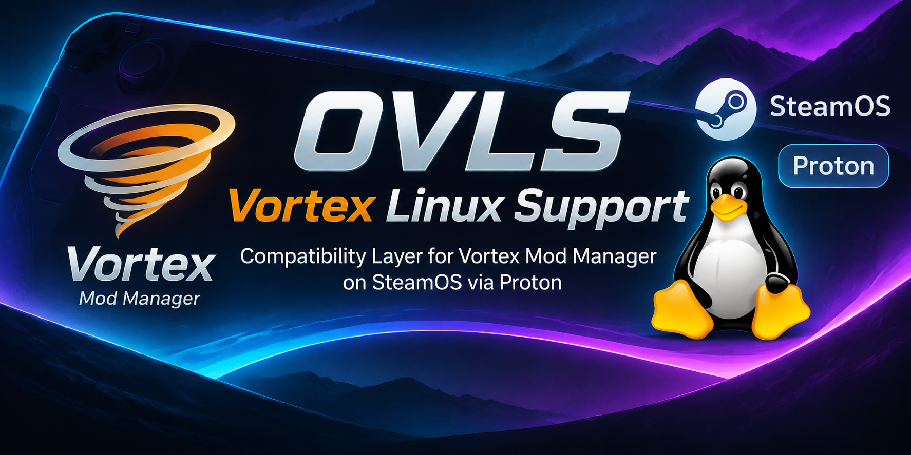

# OVLS — Linux Support for Official Vortex

Vortex is a mod manager for PC games developed by Nexus Mods. OVLS (Vortex Linux Support) is an independent external layer that enables the official Windows version of Vortex to run on SteamOS/Linux through Proton, without modifying Vortex itself.

Repository: https://github.com/Dimonchik-UA/Vortex-Linux-Support

## What OVLS does

OVLS is not Vortex, and it does not change the official Vortex application files or Vortex user settings. It is a separate, installable layer that adds Linux/SteamOS integration around the official Vortex application; it installs and removes its own Extension separately:

- **Vortex launcher** (`ovls-vortex.desktop`): Launches the official Vortex through Proton. OVLS uses the compatibility tool you selected in Steam for the Vortex prefix. When no selection is available, it prefers a recommended tool (DW-Proton or Proton-GE) and otherwise uses another installed Proton. No specific Proton version is required. Proton-GE and DW-Proton Latest did not show window issues in testing; Proton 11.0, Hotfix, and Experimental did. Name: `Vortex`. Comment: `Official Vortex on Linux`. Installed in the applications menu **and** on the desktop. Categories: `Game;`.
- **OVLS Manager** (`ovls-manager.desktop`): Installs or updates the OVLS Extension in the selected Vortex prefix and registers the NXM handler and desktop shortcuts in your user XDG directories; also handles verify, uninstall, and change prefix. Name: `OVLS Manager`. Comment: `OVLS Manager (Official Vortex Linux Support)`. Installed in the applications menu only. Categories: `Utility;`.
- **NXM handler** (`ovls-nxm.desktop`): Registers the `nxm://` protocol handler so that “Download with Vortex” buttons on Nexus Mods open in the official Vortex running through Proton. Name: `OVLS NXM Handler`. Installed as a hidden protocol-handler entry (`NoDisplay=true`), not shown as a regular application. Categories: `Game;`.

OVLS installs three shortcuts:
- **Vortex shortcut** — on the desktop and in the applications menu.
- **OVLS Manager shortcut** — in the applications menu only.
- **NXM handler** — a protocol-handler entry, not a regular menu application.

The OVLS Manager appears in the `Utility;` category of your application menu.

## How OVLS works

OVLS uses a **hybrid architecture**:

- **External Linux Support**: A Python-based component that handles SteamOS/Proton/prefix/filesystem/NXM tasks outside of Vortex.
- **Vortex Extension**: A small extension loaded inside the official Vortex that handles operations requiring Vortex context (state reading, deployment-failure notifications, and the `SET_MOD_INSTALL_PATH` staging write).
- **JSON IPC**: File-based JSON communication between the external component and the extension for queries that need to cross the boundary.

The official Vortex application files are never modified. OVLS adds its own Extension (including generated `host.json`), desktop shortcuts, an NXM handler, and launch automation around it; uninstall removes the OVLS-owned Extension files.

## Supported environment

OVLS has been tested on:

- **SteamOS 3.x, Desktop Mode (KDE Plasma)** — supported
- **SteamOS Game Mode** — not tested
- **Proton-GE Latest** — normal in testing, recommended (case-insensitive name match: starts with `GE-Proton` or contains `Proton-GE`)
- **DW-Proton Latest** — normal in testing
- **Proton 11.0** — window display and cursor offset issues observed in testing
- **Proton Hotfix** — window display and cursor offset issues observed in testing
- **Proton Experimental** — window display and cursor offset issues observed in testing
- **Python 3** — required
- **kdialog or zenity** — required for graphical dialogs; CLI works without them

OVLS does not require root access.

## Project status

OVLS is in active development. Core user flows (launch, Extension install/update, NXM, mod workflow) have been implemented and tested. Optional features such as SD-card staging and frame-extent measurements are not covered.

## Installation

OVLS is distributed as a standalone installer folder (`OVLS Installer`). Download the built package, copy it to any location, and run `install.sh`. Detailed installation instructions are included in the package itself (`installer/README.md`).

Do not run the installer from inside the source checkout unless you are developing OVLS. The standalone package is the supported distribution format.

## Downloading and running the installer from GitHub Releases

1. Open the project releases page: https://github.com/Dimonchik-UA/Vortex-Linux-Support/releases
2. Download both release files:
   - `OVLS-Installer.tar.gz`
   - `SHA256SUMS`
3. Before running the installer, verify the archive integrity using `SHA256SUMS` (it contains the expected SHA-256 checksum for `OVLS-Installer.tar.gz`). For example, from the directory where both files are located:
   ```bash
   sha256sum -c SHA256SUMS
   ```
4. Extract `OVLS-Installer.tar.gz`. The archive contains the `OVLS Installer` folder.
5. Open the extracted `OVLS Installer` folder.
6. To run the installer graphically, double-click `OVLS Installer.desktop` inside that folder. On SteamOS/KDE, if the shortcut is marked as untrusted, select **Trust and Launch** (as documented in `installer/README.md`). Keep `OVLS Installer.desktop`, `install.sh`, and the `ovls/` directory together in the same folder.
7. If graphical launch is unavailable, open a terminal in the extracted `OVLS Installer` folder and run:
   ```bash
   bash install.sh
   ```
   (This is the documented package entry point; without arguments it starts the graphical installer UI when available. See `installer/README.md` and `installer/install.sh` for details and CLI options such as `install`, `update`, `verify`, and `uninstall`.)

## Documentation

- **User documentation**: `docs/user/` — installation, usage, NXM, staging, environment matrix, diagnostics.
- **Developer documentation**: `docs/developer/` — architecture, component design, IPC contract, error handling, lifecycle.

## Known limitations

- OVLS does not guarantee compatibility with all games or all versions of Vortex.
- Mod deployment requires the staging folder to be on the same Wine disk as the game (e.g. `Z:` under Proton).
- Staging on SD cards and other non-home roots is not supported automatically.
- Game Mode has not been tested.
- OVLS does not modify the official Vortex executable or Vortex user settings; it installs its own Extension into Vortex's plugin directory and removes it on uninstall. OVLS cannot guarantee behavior with future versions of Vortex internals.

## Input limitations on Steam Deck

On Steam Deck in Desktop Mode (KDE Plasma), the following input limitations have been observed:

| Category | Observation |
|----------|-------------|
| **Window rendering / mouse** | On Proton 11.0, Hotfix, Experimental: double window controls, white band, interface shift, cursor-click offset. Not observed on Proton-GE Latest / DW-Proton Latest. |
| **Keyboard focus & text input** | Does not work correctly in any Vortex text input field. Not limited to search/profile rename. No workaround in OVLS. |
| **Touch input** | Does not work correctly in any Vortex text input field. Not limited to search/profile rename. No workaround in OVLS. |
| **Controller** | R2/L2 work via SteamOS input handling. Other controller interactions not fully tested. |

OVLS launches Vortex using standard `proton run vortex.exe` and does not implement custom input handling. The root cause (suspected Wine/Proton–Electron interaction) has not been proven. No fix is promised via Proton updates, Steam launch parameters, or OVLS updates.

## Contributing

See `CONTRIBUTING.md` for how to propose changes and report issues.

## License

OVLS source code is licensed under the MIT License. Copyright (c) 2026 Dimonchik-UA. The full license text is in the `LICENSE` file.

The MIT License covers the OVLS source code in this repository only. Vortex is a separate project by Nexus Mods and is distributed under its own terms — it is not part of this repository and is not licensed under the MIT License. Any third-party components, if present, remain under their own licenses.

Repository: https://github.com/Dimonchik-UA/Vortex-Linux-Support
